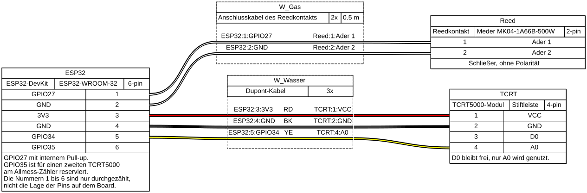

# ESPHome Zählerecke

Ein ESP32-DevKit liest den Gaszähler und den Hauptwasserzähler aus und schickt die Zählerstände an Home Assistant.

| Zähler                          | Sensor                                       | Auflösung          |
| ------------------------------- | -------------------------------------------- | ------------------ |
| Gas, Apator Metrix G4           | Reedkontakt MK04 an der letzten Ziffernrolle | 1 Impuls = 0,01 m³ |
| Wasser, Ernst Heitland (Q3 = 4) | TCRT5000 über dem x0,0001-Zeiger             | 1 Umdrehung = 1 L  |

## Verdrahtung



- Der Reedkontakt hat keine Polarität. GPIO27 nutzt den internen Pull-up: offen liest der Pin HIGH, geschlossen LOW. Einen externen Widerstand braucht es nicht.
- Vom TCRT5000 wird nur der analoge Ausgang A0 gebraucht. Das Poti auf dem Modul wirkt nur auf D0 und ist deshalb egal.
- Das DevKit hat mehrere GND-Pins, beide Sensoren können also je einen eigenen nehmen. Alles lässt sich mit Dupont-Kabeln oder Wago-Klemmen stecken, ohne zu löten.
- Die Kabelfarben sind ein Vorschlag: Rot für VCC, Schwarz für GND, Gelb für das Signal.
- Strom bekommt das Board über USB von einem 5-V/1-A-Netzteil.

Der Plan steht in `docs/verdrahtung.yaml` und wird mit [WireViz](https://github.com/wireviz/WireViz) gezeichnet. Nach einer Änderung das Bild so neu erzeugen:

```bash
podman build -t localhost/wireviz:0.4.1 -f docs/wireviz.Containerfile docs
podman run --rm --userns=keep-id -v "$PWD/docs":/data:Z localhost/wireviz:0.4.1 -f s verdrahtung.yaml
```

## Einrichtung

Zuerst die Vorlage für die Secrets kopieren und ausfüllen. Den API-Schlüssel erzeugt `openssl`:

```bash
cp secrets.yaml.example secrets.yaml
openssl rand -base64 32   # Ergebnis bei api_key_zaehlerecke eintragen
```

Beim ersten Mal wird per USB geflasht. Dafür muss der eigene Benutzer in der Gruppe `dialout` sein. Auf Systemen mit SELinux (z. B. Fedora) darf ein Container die serielle Schnittstelle außerdem nur mit `--security-opt label=disable` öffnen. Sonst meldet ESPHome fehlende Rechte, obwohl die Gruppe stimmt:

```bash
podman run --rm -it -v "$PWD":/config:Z --device /dev/ttyUSB0 --group-add keep-groups \
  --security-opt label=disable \
  ghcr.io/esphome/esphome:2026.10.2 run zaehlerecke.yaml --device /dev/ttyUSB0
```

Danach gehen Updates über WLAN. Mit `logs` statt `run` zeigt ESPHome nur das Log an:

```bash
podman run --rm -it --network host -v "$PWD":/config:Z ghcr.io/esphome/esphome:2026.10.2 run  zaehlerecke.yaml --device <IP>
podman run --rm -it --network host -v "$PWD":/config:Z ghcr.io/esphome/esphome:2026.10.2 logs zaehlerecke.yaml --device <IP>
```

## Wasser kalibrieren

1. Den TCRT5000 über die Bahn des roten x0,0001-Zeigers setzen und gegen Licht von außen abdecken.
2. Wasser laufen lassen und in Home Assistant „Wasser Sensor Min (5s)“ und „Wasser Sensor Max (5s)“ ablesen. Liegen die beiden weniger als etwa 0,3 V auseinander, ist das Signal zu schwach. Dann Abstand und Abdeckung noch einmal prüfen.
3. Die Schwellen ausrechnen, in `zaehlerecke.yaml` eintragen und per OTA flashen:
   - `water_main_threshold_upper` = Min + 0,6 × (Max − Min)
   - `water_main_threshold_lower` = Min + 0,4 × (Max − Min)
4. Zur Probe einen 10-L-Eimer füllen. Der Zählerstand sollte dabei um 0,010 m³ steigen.

## Zählerstände

Den aktuellen Stand einmal am Zähler ablesen und in „Gas Zählerstand setzen“ bzw. „Wasser Zählerstand setzen“ eintragen. Erst danach die Sensoren ins Energie-Dashboard aufnehmen. Andersherum hält Home Assistant den Sprung von 0 auf den echten Stand für Verbrauch.
